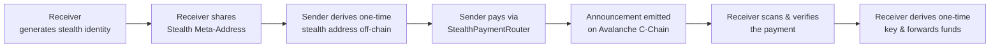
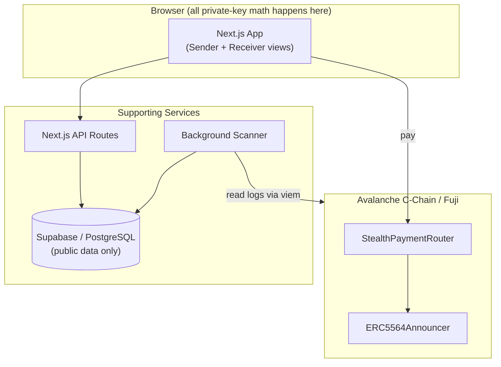

# StealthPay

**Private-by-default payments on Avalanche — receive funds without exposing your wallet identity.**

> Built for **Team1 India – Speedrun 2026** on Avalanche (*Build Anything on Avalanche* cycle).

> **Project status:** **Milestone 1 (frontend)** and **Milestone 2 (cryptographic engine)** are complete. Real ERC-5564 scheme 1 stealth address generation, detection and one-time spending-key recovery work in the browser and are covered by 53 tests — see [docs/CRYPTO_ENGINE.md](./docs/CRYPTO_ENGINE.md). Smart contracts, the backend, the scanner worker and **transaction broadcasting are not built**; nothing is deployed, and balances/transaction history remain demo data. See [Project Status](#project-status).

---

## Table of Contents

- [Introduction](#introduction)
- [The Problem](#the-problem)
- [Our Solution](#our-solution)
- [Why StealthPay Matters](#why-stealthpay-matters)
- [Core Features](#core-features)
- [How It Works](#how-it-works)
- [Architecture at a Glance](#architecture-at-a-glance)
- [Technology Stack](#technology-stack)
- [Avalanche Integration](#avalanche-integration)
- [Network Support](#network-support)
- [Project Structure](#project-structure)
- [Installation](#installation)
- [Environment Variables](#environment-variables)
- [Local Development](#local-development)
- [Smart Contract Deployment](#smart-contract-deployment)
- [Testing](#testing)
- [Demo & Deployment](#demo--deployment)
- [Security & Privacy Limitations](#security--privacy-limitations)
- [Roadmap](#roadmap)
- [Project Status](#project-status)
- [Team & Acknowledgements](#team--acknowledgements)
- [References](#references)

---

## Introduction

StealthPay is a privacy-preserving payment application on the **Avalanche C-Chain**. Instead of receiving every payment at one reusable wallet address, a StealthPay user shares a **Stealth Meta-Address** once; every sender who pays them derives a brand-new, one-time address for that specific payment. The receiver — and only the receiver — can find and spend from that address.

The result: a receiver's incoming payments are no longer trivially linkable to their primary wallet, while the payment itself still happens as an ordinary, verifiable on-chain transaction.

## The Problem

Blockchains are public ledgers. Share a wallet address to get paid, and anyone can:

- Watch every payment that address receives.
- See its running balance and full history.
- Correlate repeated use of the same address to build a profile of who you transact with and when.

This is a real privacy cost for freelancers, DAOs, traders, merchants, and everyday users — even when they've never revealed their real-world identity, repeated use of one address does the de-anonymizing work for an observer.

## Our Solution

StealthPay implements **[ERC-5564 stealth addresses](https://ercs.ethereum.org/ERCS/erc-5564)** on Avalanche:

1. A receiver publishes a public **Stealth Meta-Address** (two public keys) — never their wallet address.
2. A sender uses it to mathematically derive a fresh, one-time address for each payment and sends funds there.
3. An on-chain **Announcement** publishes just enough public data for the receiver to find the payment — and nobody else can tell it's theirs.
4. The receiver scans for payments using a private **viewing key**, verifies the transfer actually happened, and recovers the one-time **spending key** needed to move the funds — all client-side.

No mixers. No custodians. No change to how senders pay — they just interact with a payment router contract.

## Why StealthPay Matters

- **Receiver privacy without sender friction.** Senders don't need a new wallet, a new token, or a new mental model — they just pay an address, same as always.
- **Self-custodial throughout.** No party other than the receiver ever holds the keys that control the one-time stealth address.
- **Standards-based.** Built on ERC-5564, not a bespoke scheme — compatible with the broader stealth-address tooling ecosystem.
- **Honest about scope.** StealthPay protects *recipient identity unlinkability*. It does not claim to make transactions anonymous — see [Security & Privacy Limitations](#security--privacy-limitations).

## Core Features

- 🔑 **Stealth identity generation** — client-side viewing + spending key pair generation.
- 🔗 **Shareable Stealth Meta-Address** — QR code / link / copyable string.
- 💸 **One-time address derivation** — computed entirely in the sender's browser before payment.
- 📡 **On-chain announcements** — ERC-5564-compliant, emitted atomically with the payment.
- 🔍 **Payment scanning & detection** — view-tag-optimized scanning with on-chain transfer verification.
- 🧾 **Receiver dashboard** — see detected payments: asset, amount, stealth address, tx hash, status.
- ➡️ **One-click forwarding** — spend a detected payment directly to any third-party address.
- ⛓️ **Avalanche-native** — built and demoed on Avalanche Fuji C-Chain.

## How It Works



For the full cryptographic walkthrough (keys, formulas, sequence diagrams, scanning architecture), see **[PROJECT_FLOW.md](./PROJECT_FLOW.md)**.

## Architecture at a Glance



## Technology Stack

| Layer | Technology | Status |
|---|---|---|
| Frontend | Next.js 16 (App Router), React 19, TypeScript 5, Tailwind CSS 4 | **Built** |
| UI | Custom Neo-Brutalist design system, Radix primitives (dialog, dropdown), lucide-react, `qrcode.react` | **Built** |
| Wallets | EIP-6963 discovery + EIP-1193 requests, viem types — MetaMask & Core compatible | **Built** |
| Blockchain reads | Public Avalanche JSON-RPC (`eth_blockNumber` health check) | **Built** |
| Blockchain | Avalanche C-Chain, Solidity, Hardhat, OpenZeppelin, ERC-5564 | Planned |
| Cryptography | `@scopelift/stealth-address-sdk` 1.0.0-beta.5, `@noble/secp256k1`, viem — ERC-5564 scheme 1 | **Built** |
| Backend | Node.js, TypeScript, Next.js API routes, standalone scanner worker | Planned |
| Database | Supabase (PostgreSQL) — public metadata only, never private keys | Planned |
| Deployment | Vercel (frontend), Railway or similar (scanner worker), Hardhat (contracts) | Planned |
| Testing (crypto) | Vitest 5 — 53 tests, 7 files | **Built** |
| Testing (contracts) | Hardhat tests | Planned |

Full rationale for every choice is in **[TECH_STACK.md](./TECH_STACK.md)**.

> **Deviation from the documented stack:** the wallet layer uses EIP-6963/EIP-1193 directly instead of Wagmi. Wagmi v3's connector graph pulls in a conflicting optional peer tree (`accounts` → `@privy-io/react-auth` → `permissionless` → `ox`) that fails to install cleanly, and this milestone needs only connect / read address / switch chain / disconnect — no contract calls. [`src/lib/eip1193.ts`](src/lib/eip1193.ts) is the seam where a fuller connector stack can be reintroduced once contract interaction lands.

## Avalanche Integration

StealthPay is built directly against the **Avalanche C-Chain**, an EVM-compatible chain, which means:

- Standard Solidity contracts (`StealthPaymentRouter`, `ERC5564Announcer`) deploy and run unmodified.
- Stealth addresses derived via SECP256k1 are fully compatible Avalanche C-Chain addresses — no bridging or wrapping needed.
- All demo transactions (payment, announcement, forwarding) are real, verifiable transactions on **Avalanche Fuji C-Chain**, viewable on [Snowtrace Testnet Explorer](https://testnet.snowtrace.io/).
- Avalanche-specific primitives (eERC, ICM, ICTT) are **not required** for this problem and are intentionally not used in the MVP — StealthPay's focus is the stealth-address privacy model, not maximizing the number of Avalanche features touched.

## Network Support

| Network | Chain ID | RPC Endpoint | Explorer | Role |
|---|---|---|---|---|
| **Avalanche Fuji (Testnet)** | `43113` | `https://api.avax-test.network/ext/bc/C/rpc` | [testnet.snowtrace.io](https://testnet.snowtrace.io/) | **Default** development & demo network |
| **Avalanche C-Chain (Mainnet)** | `43114` | `https://api.avax.network/ext/bc/C/rpc` | [snowtrace.io](https://snowtrace.io/) | Future production target (not used during development) |

Fuji is the default network everywhere in the app. Real assets are never used during development or demos.

## Project Structure

Current layout — the frontend exists; directories marked *planned* do not.

```
stealth pay team1/
├── src/
│   ├── app/
│   │   ├── page.tsx                 # Landing page
│   │   ├── layout.tsx               # Fonts, metadata, providers
│   │   ├── globals.css              # Neo-Brutalist design tokens
│   │   └── (app)/                   # Authenticated app shell
│   │       ├── layout.tsx           # Sidebar + topbar + mobile nav
│   │       ├── dashboard/  receive/  send/
│   │       └── activity/  identity/  scanner/  settings/
│   ├── components/
│   │   ├── ui/                      # Design-system primitives
│   │   ├── layout/                  # Site header/footer, app sidebar/topbar
│   │   ├── landing/                 # Marketing sections + diagrams
│   │   ├── dashboard/  payments/  scanner/  identity/  settings/
│   │   ├── wallet/                  # Connect, network selector, wallet panel
│   │   └── shared/                  # Logo, page header, demo banner
│   ├── config/                      # networks.ts, nav.ts, site.ts
│   ├── data/mock/                   # Demo data (clearly separated from UI)
│   ├── hooks/                       # RPC status, scanner simulation
│   ├── lib/                         # utils, format, EIP-1193, placeholders
│   ├── providers/                   # Wallet + toast providers
│   └── types/                       # Shared domain types
├── contracts/                        # PLANNED — Hardhat project
├── workers/scanner/                  # PLANNED — background scanner
├── PROJECT_FLOW.md
├── README.md
└── TECH_STACK.md
```

## Installation

Requires **Node.js 20+** (developed on Node 26) and npm.

```bash
git clone <repository-url>
cd "stealth pay team1"
npm install
```

## Environment Variables

The frontend currently needs **no environment variables** — network configuration lives in [`src/config/networks.ts`](src/config/networks.ts) and Fuji is the default. The variables below are planned for when the contracts, backend and scanner land.

```bash
# Avalanche network
NEXT_PUBLIC_CHAIN_ID=43113
NEXT_PUBLIC_RPC_URL=https://api.avax-test.network/ext/bc/C/rpc

# Deployed contracts (filled in after deployment — see below)
NEXT_PUBLIC_ANNOUNCER_ADDRESS=
NEXT_PUBLIC_ROUTER_ADDRESS=

# Supabase
NEXT_PUBLIC_SUPABASE_URL=
NEXT_PUBLIC_SUPABASE_ANON_KEY=
SUPABASE_SERVICE_ROLE_KEY=

# Contract deployment (Hardhat) — testnet only, never a funded mainnet key
FUJI_DEPLOYER_PRIVATE_KEY=
```

**Never commit `.env` files.** The deployer key above is for **Fuji testnet only** and must never hold mainnet funds.

## Local Development

```bash
npm run dev        # start the dev server on http://localhost:3000
npm run build      # production build
npm start          # serve the production build
npm run lint       # ESLint
npm run typecheck  # tsc --noEmit
```

Routes: `/` (landing), `/dashboard`, `/receive`, `/send`, `/activity`, `/identity`, `/scanner`, `/settings`.

> **Low-memory machines:** the production build fans out to one worker per CPU during static generation. If `npm run build` crashes with an out-of-memory or worker error, add `experimental: { cpus: 1 }` to [`next.config.ts`](next.config.ts) or close memory-heavy applications first.

The scanner worker is not implemented yet, so there is no second process to run.

## Smart Contract Deployment

> Planned workflow using Hardhat, targeting Fuji first. The `contracts/` project does not exist yet.

```bash
cd contracts
npx hardhat compile
npx hardhat run scripts/deploy.ts --network fuji
```

Deployment will:
1. Verify whether the official ERC-5564 reference `ERC5564Announcer` is already deployed at its deterministic address on Fuji; deploy it there if not.
2. Deploy `StealthPaymentRouter`, configured to call that `ERC5564Announcer`.
3. Record both addresses below once deployed.

**Deployed Contracts (Fuji Testnet):**

| Contract | Address | Explorer Link |
|---|---|---|
| `ERC5564Announcer` | _TBD — not yet deployed_ | _TBD_ |
| `StealthPaymentRouter` | _TBD — not yet deployed_ | _TBD_ |

## Testing

```bash
npm test           # Vitest — 53 crypto-engine tests (7 files)
npm run typecheck  # tsc --noEmit, strict mode
npm run lint       # ESLint (eslint-config-next, flat config)
npm run build      # production build + type check + prerender all routes
```

The crypto suite covers key generation, meta-address encoding/parsing, sender
derivation, receiver scanning, spending-key derivation, the full end-to-end
round trip, and SDK interoperability/convention pinning. Breakdown in
[docs/CRYPTO_ENGINE.md §6](./docs/CRYPTO_ENGINE.md).

Planned once the contracts land:

```bash
cd contracts && npx hardhat test   # contract tests (not yet written)
```

## Demo & Deployment

| Item | Link |
|---|---|
| Live demo | _TBD_ |
| Demo video (≤ 3 min) | _TBD_ |
| Pitch slides | _TBD_ |
| GitHub repository | _TBD_ |

## Security & Privacy Limitations

**StealthPay provides recipient identity unlinkability — not complete transaction anonymity.** Read this section before assuming more than the system actually guarantees.

**What StealthPay hides:** the cryptographic link between a one-time stealth address and the receiver's reusable wallet identity.

**What StealthPay does *not* hide:**
- The sender's address.
- The stealth (destination) address itself, and the amount sent to it.
- Transaction timing.
- Any subsequent transaction when the receiver forwards funds onward.
- The overall public transaction graph — it simply isn't labeled with the receiver's primary identity.

**StealthPay is not:** a mixer, a confidential-balance system, or a zero-knowledge privacy protocol. It does not provide sender anonymity or protection against sophisticated correlation analysis.

**Other key security notes** (full detail in [PROJECT_FLOW.md §21](./PROJECT_FLOW.md#21-security-considerations)):
- Private keys (viewing, spending, ephemeral, and derived one-time keys) are generated and used client-side only, and are never sent to a backend API or stored in Supabase.
- Every detected payment is verified against an actual on-chain transfer — an announcement alone is never treated as proof of payment.
- ERC-20 support (planned, post-MVP) introduces a gas-funding problem — a stealth address holding only tokens has no AVAX to pay for its own outgoing transaction. See [PROJECT_FLOW.md §22](./PROJECT_FLOW.md#22-gas-management) for the candidate solutions under evaluation.

## Roadmap

- [x] Architecture and cryptographic design documented.
- [x] Next.js app scaffolded with the Neo-Brutalist design system.
- [x] Landing page and all seven dashboard screens built.
- [x] Wallet connection (EIP-6963 discovery, address display, Fuji/Mainnet switching, disconnect).
- [x] Meta-address sharing UI with QR code generation.
- [ ] Hardhat project and scanner worker scaffolding.
- [x] Client-side stealth key generation and full ERC-5564 scheme 1 derivation (Milestone 2).
- [x] Receiver announcement matching and one-time spending-key recovery, with a verified round trip.
- [ ] `StealthPaymentRouter` + `ERC5564Announcer` deployed to Fuji.
- [ ] Native AVAX payment flow (send → announce → detect → forward) working end-to-end on Fuji.
- [ ] Receiver dashboard with detected-payment list.
- [ ] Cryptographic test vectors validated against the ERC-5564 reference implementation.
- [ ] ERC-20 token support + gas-funding mechanism.
- [ ] Relayer-based gas sponsorship (future).
- [ ] Mainnet C-Chain deployment (future, post security review).

## Project Status

To keep this README honest and avoid overstating progress:

**Built and working**
- **Cryptographic engine (Milestone 2):** real ERC-5564 scheme 1 (SECP256k1) identity generation, meta-address build/parse, sender one-time address derivation, receiver announcement matching, and one-time spending-key recovery — all client-side. 53 tests across 7 files, including a full Alice → Bob → Alice round trip proving the recovered key controls exactly the address the sender generated. See [docs/CRYPTO_ENGINE.md](./docs/CRYPTO_ENGINE.md).
- The full frontend: landing page plus `/dashboard`, `/receive`, `/send`, `/activity`, `/identity`, `/scanner`, `/settings`.
- A coherent Neo-Brutalist design system (tokens, components, responsive desktop/tablet/mobile layouts).
- Real wallet connection via EIP-6963/EIP-1193 — connect, show address, switch to Fuji or Mainnet, disconnect.
- A genuine live read of the public Avalanche RPC (`eth_blockNumber`) on the Dashboard and Settings.
- Real QR code generation and download, encoding the actual stealth meta-address.

**Still demo data, not real**
- Balances, payment history, transaction hashes, block numbers and scanner counters come from [`src/data/mock/`](src/data/mock/). Every app screen carries a persistent "Frontend preview" banner.
- The Scanner's event feed is a scripted simulation — it performs no RPC log scanning. (Its *announcement checker* is real crypto.)

**Not built**
- Smart contracts and deployments, the payment router, the ERC-5564 Announcer, the backend API, Supabase, the scanner worker, and **transaction broadcasting**. The Send flow derives a real address but never signs or submits anything, and never fabricates a transaction hash.

**Security posture — read this**
- Private keys (viewing, spending, ephemeral, derived one-time) are generated and used **only in the browser**. They are never sent to an API route, written to a database, placed in `localStorage`/`sessionStorage`, logged, or encoded into a URL or QR code.
- Stealth keys are a **separate key system** from the connected MetaMask/Core account and are never derived from it.
- The identity lives in memory for the session only. **There is no backup or recovery** — a refresh destroys it. That is deliberate for this milestone.
- The engine is **not independently audited** and depends on a **beta** SDK (`1.0.0-beta.5`, pinned). Fuji testnet only.

**Not yet decided**
- The scanning architecture (fully client-side vs. a protected server-side scanner — see [PROJECT_FLOW.md §19](./PROJECT_FLOW.md#19-backend-and-database-architecture)), and the ERC-20 gas-funding mechanism to ship first.

**No contracts are deployed.** No address in this document is real until the deployment table above is filled in.

## Team & Acknowledgements

Built for **Team1 India – Speedrun 2026** ([event details](https://docs.avax.network/events/3f8d455d-1eb5-425b-b859-4261a0ff8ad6)).

- Team: _TBD_
- AI tools used (per Speedrun disclosure requirements): **Claude (Claude Code)** was used to draft the project architecture documentation (`PROJECT_FLOW.md`, `TECH_STACK.md`, this README) and to implement the frontend UI — the design system, landing page, dashboard screens, wallet layer and mock data. All cryptographic design decisions follow the ERC-5564 specification and remain subject to human review and test-vector validation before any mainnet use.

## References

- [ERC-5564: Stealth Addresses](https://ercs.ethereum.org/ERCS/erc-5564)
- [Avalanche C-Chain Documentation](https://build.avax.network/docs/primary-network)
- [Avalanche C-Chain RPCs](https://build.avax.network/docs/rpcs/c-chain)
- [Avalanche Fuji Testnet Explorer](https://build.avax.network/explorer/fuji/c-chain)
- [Team1 India – Speedrun 2026](https://docs.avax.network/events/3f8d455d-1eb5-425b-b859-4261a0ff8ad6)
- [docs/CRYPTO_ENGINE.md](./docs/CRYPTO_ENGINE.md) — cryptographic engine: architecture, verified conventions, security limits
- [PROJECT_FLOW.md](./PROJECT_FLOW.md) — full technical blueprint
- [TECH_STACK.md](./TECH_STACK.md) — detailed stack rationale
